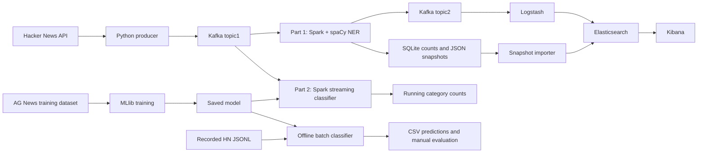

# CS4371 Group Project 1 
This project analyzes Hacker News stories and comments using two pipelines: Part 1 performs named entity recognition (NER) and visualizes entity frequencies; Part 2 uses a trained AG News classifier for offline evaluation and live streaming inference.

## Start here: what this guide runs

Follow Sections 1–8 in order. The default workflow uses the **committed 60-minute snapshots, exported Kibana dashboard, fitted AG News model, original batch prediction CSVs and manual labels**. No model retraining, new offline batch job, or 60-minute data collection is required. The only new collection is a short, two-minute Part 2 live demonstration.

The appendices at the very bottom are independent, optional procedures for readers who want to repeat expensive experiments or training. Do not execute them as part of the default workflow.

## 1. Architecture



The offline batch predictions are not inputs to the live classifier. Both classifiers load the same fitted model. Kafka, Logstash, Elasticsearch and Kibana run in Docker; Python and Spark run on the host.

## 2. Check and install prerequisites

### 2.1 Choose your operating system

The original project was tested on Ubuntu with Python 3.14, Java 21, PySpark 4.1.3, Kafka 4.1.2 and Elastic Stack 9.5.5. The following are installation paths for different operating systems; native macOS and Windows/WSL execution have not been independently tested.

- **Linux:** Use Bash and Docker Engine with Compose v2.
- **macOS:** Use Terminal (Bash or zsh) and Docker Desktop for your CPU architecture. If dependencies or images are unavailable for Apple Silicon, use a compatible Linux VM or remote Linux machine.
- **Windows:** Use WSL 2 with Ubuntu and Docker Desktop WSL integration. The project shell scripts are written for a Unix-like shell, not native PowerShell. Keep the clone in the WSL filesystem, not under `/mnt/c`.

Windows users without WSL: run the following one-time command in administrator PowerShell, reboot if requested, and finish Ubuntu setup before proceeding in the Ubuntu terminal:

```powershell
wsl --install -d Ubuntu
```

Install Docker Desktop on Windows or macOS if missing: https://docs.docker.com/get-docker/. Start it, and on Windows enable integration for the chosen WSL distribution. On native Linux, install Docker Engine and the Compose plugin using the distribution-specific instructions at the same link. Do not install a competing Docker daemon inside WSL when using Docker Desktop.

### 2.2 Check installed tools

**Where:** Your chosen project terminal. On Windows this means WSL, not PowerShell.

```bash
git --version
python3 --version
java -version
uv --version
docker --version
docker compose version
tmux -V
```

A missing-command error identifies a prerequisite to install. The project requires Java 21 and Python 3.14; uv can install Python without replacing the system Python. A different system `python3` version is acceptable if the project uses Python 3.14 through uv.

### 2.3 Install missing tools (only your platform)

Use the applicable subsection below, then proceed to Step 2.4. Commands are separate so you can skip tools that are already installed.

**Ubuntu/Debian or Ubuntu WSL**

For missing Git, curl or tmux, use apt (omit packages already installed):

```bash
sudo apt update
sudo apt install -y git curl tmux
```

For missing Java 21:

```bash
sudo apt install -y openjdk-21-jdk-headless
```

For missing uv:

```bash
curl -LsSf https://astral.sh/uv/install.sh | sh
```

Make uv available if installed in the default user directory:

```bash
export PATH="$HOME/.local/bin:$PATH"
```

Other Linux distributions should use their own package manager for Git, curl, tmux and Java 21.

**macOS**

Install Homebrew first if needed, following https://brew.sh/. Then install only the missing packages, using the matching command(s):

```bash
brew install git
```

```bash
brew install tmux
```

```bash
brew install openjdk@21
```

```bash
brew install uv
```

### 2.4 Configure Java 21

Run **only the block for your Java installation**, not all three blocks. These exports apply to the current shell; repeat in a new shell when needed.

**Linux / WSL (system Java 21 selected):**

```bash
export JAVA_HOME="$(dirname "$(dirname "$(readlink -f "$(command -v java)")")")"
export PATH="$JAVA_HOME/bin:$HOME/.local/bin:$PATH"
```

**macOS with Homebrew Java 21:**

```bash
export JAVA_HOME="$(brew --prefix openjdk@21)/libexec/openjdk.jdk/Contents/Home"
export PATH="$JAVA_HOME/bin:$HOME/.local/bin:$PATH"
```

**macOS with a registered Java 21 JDK, such as Adoptium (instead of Homebrew):**

```bash
export JAVA_HOME="$(/usr/libexec/java_home -v 21)"
export PATH="$JAVA_HOME/bin:$HOME/.local/bin:$PATH"
```

Verify Java. If the version is not 21, select the Java 21 installation before proceeding.

```bash
"$JAVA_HOME/bin/java" -version
```

### 2.5 Install and verify the project Python version

```bash
uv python install 3.14
uv python find 3.14
```

Expected: a valid Python 3.14 executable path. uv may reuse an existing compatible interpreter.

### 2.6 Final prerequisite check

```bash
git --version
uv --version
uv python find 3.14
java -version
docker info
docker compose version
tmux -V
```

Expected: all commands succeed, Java reports version 21, and `docker info` shows a running daemon. The commands below assume Docker access without sudo. On Linux, if only `sudo docker info` works, configure Docker access following official guidance or use sudo for the explicit Docker commands; the optional Bash experiment runner itself requires ordinary Docker access. Docker daemon access is privileged. Do not change socket permissions to make it accessible to everyone.

## 3. Clone and configure the project

### 3.1 Clone the repository

**Where:** Project terminal, in a directory where you want the repository stored. Access to the GitHub repository may require authorization.

```bash
git clone https://github.com/mhuy26/CS4371-Project1.git
cd CS4371-Project1
```

Expected: the repository downloads successfully. All subsequent shell commands run from this repository root unless explicitly stated otherwise. Do not copy any personal storage paths from another machine.

### 3.2 Install the locked dependencies

```bash
uv sync --locked --python 3.14
uv run --no-sync python --version
```

Expected: a new `.venv` and Python 3.14. Install the English spaCy model into this environment:

```bash
uv pip install pip
uv run --no-sync python -m spacy download en_core_web_sm
```

Verify:

```bash
uv run --no-sync python -c 'import pyspark, spacy, kafka; print("PySpark:", pyspark.__version__); print("spaCy:", spacy.__version__); print("Kafka:", kafka.__version__); spacy.load("en_core_web_sm"); print("NER model loaded")'
uv lock --check
```

Expected: PySpark 4.1.3, spaCy 3.8.16 and kafka-python 3.0.11 in the original locked environment, plus a successful NER model load. The Spark Kafka connector must match PySpark 4.1.3. Internet access is needed for installation and Spark connector resolution.

### 3.3 Configure environment and local storage

```bash
cp .env.example .env
mkdir -p docker-data spark-tmp
export SPARK_LOCAL_IP=127.0.0.1
export SPARK_LOCAL_DIRS="$PWD/spark-tmp"
```

This assumes a fresh clone without `.env`. If repeating this setup on an existing clone, retain the existing `.env` instead of replacing it. The template uses `GP1_DATA_DIR=./docker-data`, and the model path is relative to the repository. On a different storage device, set `GP1_DATA_DIR` in `.env` to your own writable directory. The saved model is already supplied; ignore any older template comment requesting initial training. Never commit `.env` or credentials.

### 3.4 Check the supplied reproduction artifacts

```bash
ls experiments/run01/snapshots/
ls config/kibana-dashboard.ndjson
ls models/agnews_tfidf_lr/
wc -l data/part2_combined.jsonl
ls outputs/part2/all_predictions/part-*.csv
ls outputs/part2/part2_manual_50.csv outputs/part2/evaluation.txt
```

Expected: four historical snapshots (15, 30, 45, 60 minutes), the exported dashboard, model directories `metadata` and `stages`, 1,165 JSONL lines, and prediction/evaluation files. If these are missing, verify repository access and that you cloned the current main branch before proceeding.

## 4. Start and verify Docker infrastructure

### 4.1 Start the services

**Where:** Project terminal, repository root. On a machine already running another Kafka/Elastic stack, first resolve port and Compose project-name conflicts. Do not stop unrelated services.

```bash
docker compose -f docker-compose.yml -f docker-compose.elastic.yml config --quiet
docker compose -f docker-compose.yml -f docker-compose.elastic.yml up -d
```

Expected: Kafka, Elasticsearch, Kibana and Logstash start. Allocate sufficient RAM and disk space for Docker and host Spark.

### 4.2 Verify the infrastructure

```bash
docker compose -f docker-compose.yml -f docker-compose.elastic.yml ps
```

Expected: all four containers show `Up`. Check Kafka directly inside its container:

```bash
docker exec cs4371-gp1-kafka-1 /opt/kafka/bin/kafka-topics.sh \
  --bootstrap-server localhost:19092 --list
```

Expected: successful topic listing (a new broker may not have project topics yet). The default container name uses the Compose project name `cs4371-gp1` from `.env.example`. Host applications connect to `localhost:9092`; container-to-container connections use `kafka:19092`.

Check Elasticsearch:

```bash
curl -fsS 'http://127.0.0.1:9200/_cluster/health?pretty'
```

Expected: green or yellow, with zero unassigned primary shards. Yellow is normal on a single-node cluster with unassigned replicas. Check Kibana:

```bash
curl -I http://127.0.0.1:5601
```

Expected: HTTP response after Kibana finishes initialization. Inspect Logstash startup:

```bash
docker logs --tail 60 cs4371-gp1-logstash-1
```

Expected: pipeline started, no persistent fatal connection errors. If any service is still starting, repeat its check before continuing. For a local demonstration the Elastic stack is configured without authentication; do not expose these ports publicly.

## 5. Part 1 — Restore the recorded results (no new experiment)

Part 1 collects Hacker News messages into Kafka topic1, runs spaCy NER in Spark, aggregates entity counts, and publishes results into topic2. Logstash indexes those results in Elasticsearch. Separately, the recorded interval snapshots are imported into a historical index for Kibana. The default workflow below restores those snapshots rather than collecting more data.

### 5.1 Inspect the recorded experiment and import its snapshots

```bash
ls -lh experiments/run01/snapshots/
```

Expected: `entities_15min.json`, `entities_30min.json`, `entities_45min.json`, `entities_60min.json`.

On a fresh Elasticsearch stack, use the repository's historical snapshot importer to index the four JSON files in `cs4371-entities-history-run01`. First inspect its actual CLI:

```bash
uv run --no-sync python part1/src/import_snapshots.py --help
```

**Documentation verification gap:** the exact importer arguments have not been confirmed against the current repository source. Use the displayed arguments for the snapshot location, historical index, and Elasticsearch endpoint (`http://localhost:9200`); if the importer accepts a run ID, use `run01`. The importer must preserve the historical timestamps and `elapsed_minutes` values. Do not substitute the general live entity index. No new 60-minute experiment is required. This is the one main-path command that still needs an exact verified invocation before the guide can be considered fully copy-and-run.

After the import, verify the index:

```bash
curl -fsS 'http://127.0.0.1:9200/cs4371-entities-history-run01/_count?pretty'
```

Expected: a nonzero count (845 documents were observed in the restored original historical index). If the index is missing or empty, resolve the importer step before proceeding to the dashboard.

### 5.2 Import the saved Kibana dashboard

**Where:** Project terminal, repository root.

```bash
curl -fsS -X POST 'http://127.0.0.1:5601/api/saved_objects/_import' \
  -H 'kbn-xsrf: true' \
  --form file=@config/kibana-dashboard.ndjson
```

Expected: JSON reporting successful import. On an existing stack with conflicting saved objects, inspect the conflicts rather than overwriting existing dashboards blindly. The NDJSON contains saved dashboard and data-view definitions, not the underlying Elasticsearch documents.

### 5.3 Open Kibana and view the charts

If the browser is on the same machine as Docker, open `http://localhost:5601` (on Windows with WSL, use the Windows browser and Docker Desktop's forwarded localhost port).

If the project is on a remote machine, use a **separate terminal on your client computer** to run the following command instead. Replace USER and HOST with your actual SSH login and server address. Keep that terminal open and open `http://localhost:5601` in the client browser:

```bash
ssh -N -L 5601:127.0.0.1:5601 USER@HOST
```

In Kibana, go to **Dashboards → CS4371 GP1 — Historical Entity Frequencies**. Set an absolute date range from October 1 to November 15, 2026 if needed and refresh. The four panels show the top ten entity names by sum of count, filtered by `elapsed_minutes` 15, 30, 45 and 60.

Expected historical result:

| Interval | AI occurrences |
|---|---:|
| 15 minutes | 17 |
| 30 minutes | 23 |
| 45 minutes | 27 |
| 60 minutes | 30 |

The original producer delivered 405 messages. These are recorded results, not a new experiment. The saved dashboard should show all four panels; if empty, check the historical index, date range and data view. This completes Part 1 for the default demonstration.

## 6. Part 2 — Inspect the supplied model and offline results

### 6.1 Verify the fitted model

```bash
ls -lh models/agnews_tfidf_lr/
```

Expected: `metadata` and `stages`. Use this model for the rest of the guide. It was trained on 120,000 AG News examples with RegexTokenizer, StopWordsRemover, HashingTF, IDF and LogisticRegression. The repository includes the fitted model; **do not train it again for the default workflow**.

### 6.2 Inspect the original batch predictions

```bash
wc -l data/part2_combined.jsonl
uv run --no-sync python - <<'PYCODE'
import csv
from collections import Counter
from pathlib import Path
counts = Counter()
examples = []
for path in sorted(Path('outputs/part2/all_predictions').glob('part-*.csv')):
    with path.open(newline='', encoding='utf-8') as f:
        for row in csv.DictReader(f):
            counts[row['predicted_class']] += 1
            if len(examples) < 3:
                examples.append(row)
for name in ('World', 'Sports', 'Business', 'Sci/Tech'):
    print(name, counts[name])
print('Total:', sum(counts.values()))
for row in examples:
    print(row['text'][:120], row['predicted_class'], row['predicted_probability'])
PYCODE
```

Expected: 1,165 predictions and example texts with category and probability.

| Category | Count |
|---|---:|
| World | 45 |
| Sports | 122 |
| Business | 193 |
| Sci/Tech | 805 |
| Total | 1,165 |

### 6.3 Verify the manual evaluation

```bash
cat outputs/part2/evaluation.txt
uv run --no-sync python part2/src/part2_evaluate.py \
  --labeled-csv outputs/part2/part2_manual_50.csv
```

Expected: 50 manually reviewed, 6 outside the four categories, 44 eligible, 34 correct, 77.27% accuracy. This lightweight evaluation uses the original labeled predictions; it does not run Spark training or classify the dataset again. Prediction counts alone are not accuracy measurements. Both offline and streaming classifiers use the same saved model, not each other's predictions.

## 7. Part 2 — Run a short live streaming demo

### 7.1 Create a fresh demo topic and state directory

**Where:** Project terminal outside tmux. This example uses the ID `part2-repro01` for a first run. If reusing a machine, use a fresh ID consistently in all commands to avoid accumulating previous counts.

```bash
mkdir -p experiments/part2-repro01/checkpoint
docker exec cs4371-gp1-kafka-1 /opt/kafka/bin/kafka-topics.sh \
  --bootstrap-server localhost:19092 --create \
  --topic topic1-part2-repro01 --partitions 1 --replication-factor 1
```

Expected: `Created topic topic1-part2-repro01.` If it already exists, choose another fresh ID and use it throughout Section 7. The new database, JSONL and checkpoint paths are separate from committed files.

### 7.2 Start tmux Window 0 — classifier

**Where:** Same project terminal. Java and uv should already be configured in this shell from Section 2.

```bash
tmux new-session -s part2-repro -n classifier
```

Expected: tmux opens with `0:classifier*` in the status bar. If using a new shell where Java or uv are no longer configured, apply the platform-specific exports in Step 2.4 before starting Spark.

**Where:** Inside Window 0 (`classifier`), repository root.

```bash
export SPARK_LOCAL_IP=127.0.0.1
export SPARK_LOCAL_DIRS="$PWD/spark-tmp"
uv run --no-sync python part2/src/part2_stream.py \
  --model models/agnews_tfidf_lr \
  --topic topic1-part2-repro01 \
  --bootstrap localhost:9092 \
  --checkpoint experiments/part2-repro01/checkpoint \
  --trigger-seconds 10 --from-earliest
```

Expected: Spark initializes, loads the model and announces streaming classification. It should stay running. Do not proceed if a traceback returns you to the shell prompt. `--from-earliest` applies when there is no previous checkpoint. No counts are required before the producer sends data.

### 7.3 Create and enter Window 1 — producer

While Spark runs in Window 0, press **Ctrl+B**, release both keys, then press **C**. This opens Window 1 and leaves the classifier running. In the new window, run:

```bash
tmux rename-window producer
tmux list-windows
```

Expected: `0:classifier-` and `1:producer*`. The asterisk marks the active window. If you accidentally detached, run `tmux attach -t part2-repro` from the normal terminal, then press Ctrl+B followed by 1 to enter the producer window. Do not create a second classifier.

### 7.4 Start the producer

**Where:** Window 1 (`producer`), repository root. Verify `pwd` if needed; if uv is unavailable in this new shell, restore its PATH as in Step 2.3.

```bash
uv run --no-sync python part1/src/producer.py \
  --broker localhost:9092 \
  --topic topic1-part2-repro01 \
  --interval 5 --duration 2 --max-items 100 \
  --database experiments/part2-repro01/producer.db \
  --output experiments/part2-repro01/messages.jsonl
```

Expected: the producer retrieves live Hacker News stories and comments and publishes messages to the same Kafka topic as the classifier. Duration is two minutes; polling interval must be at least five seconds. `--max-items` configures the producer's item limit; do not interpret it as a guaranteed total message count. Output and database paths isolate this demo from the committed datasets.

### 7.5 View live classification

While Window 1 runs, press **Ctrl+B**, release, then **0**. You are now in Window 0 (`classifier`). Spark should print tables containing `predicted_class` and `count`, with `Batch: N` headings. These are live streaming micro-batches, not the offline batch classification job. Counts are cumulative within this checkpoint. Observe the table changing as messages arrive.

### 7.6 Finish and stop the demo

Press **Ctrl+B**, then **1** to return to Window 1. Let the producer finish automatically and return to its shell prompt. Note its delivered-message total. Press **Ctrl+B**, then **0** to return to the classifier. Allow Spark to process the remaining Kafka backlog and capture the final visible classification table. Only then press **Ctrl+C** in Window 0. The classifier otherwise waits indefinitely for more messages; Kafka does not signal producer completion to Spark.

The original demonstration displayed cumulative counts of World 51, Sports 67, Business 119 and Sci/Tech 431 (668 total) using a reused topic/checkpoint. These are not expected counts for a new two-minute run. Verify delivered messages versus committed Spark progress and Kafka end offsets before claiming full consumption. Empty text is filtered, so delivered counts and classified counts may differ. A Ctrl+C Py4J traceback was observed after successful output in the original demonstration; check the process has exited rather than claiming a clean shutdown from the traceback alone.

From the Window 0 shell prompt, run:

```bash
pgrep -af '[p]art2_stream.py|[p]roducer.py'
```

Expected: no demo producer/classifier processes (on macOS use `pgrep -fl 'part2_stream.py|producer.py'` if `-a` is unsupported). Other unrelated processes should not be stopped. Press Ctrl+B then D to detach when finished.

## 8. Completion and shutdown

The default workflow is now complete. Original Part 1 charts, saved Part 2 offline predictions, the original manual evaluation, and a new short streaming demonstration are the intended evidence. To stop only this project's Docker services after the demonstration, run from the repository root:

```bash
docker compose -f docker-compose.yml -f docker-compose.elastic.yml stop
```

This preserves volumes and data. Do not run `down -v` or delete historical snapshots/checkpoints simply to repeat the demo.

### Reproducibility and verification status

- The original project and live demos were executed successfully on Ubuntu.
- GitHub synchronization, a fresh repository clone, installed dependencies, the lock file, and committed datasets/model/predictions/dashboard were verified.
- A complete clean-environment execution, the exact snapshot importer invocation, independent dashboard restoration, and native macOS/Windows execution have not been verified.
- Historical results are fixed artifacts; new Hacker News streams vary over time. The preserved model and input dataset are the basis for comparing offline predictions. No accuracy claim is made for the new unlabelled live stream.

### Troubleshooting

| Problem | Action |
|---|---|
| `uv: command not found` | Check Step 2.3 and add `$HOME/.local/bin` to PATH if applicable. |
| `JAVA_GATEWAY_EXITED` | Verify Java 21 and `JAVA_HOME` in the classifier shell. |
| Missing spaCy model | Repeat the model installation in Step 3.2. |
| Checkpoint mkdir failure | Use a writable relative checkpoint directory and create it before starting Spark. |
| Kafka connection refused | Check container status and host port 9092. |
| Kibana says Configure Elastic | Verify Elasticsearch is running first. |
| Empty historical panels | Verify imported index, data view and date range. |
| No live classifications | Ensure producer and classifier use the same fresh topic and inspect Spark logs. |
| Ctrl+C Py4J traceback | Check the last completed batch and verify the classifier process exited. |

### References

- Hacker News API: https://github.com/HackerNews/API
- AG News: https://huggingface.co/datasets/fancyzhx/ag_news
- Spark: https://spark.apache.org/
- Kafka: https://kafka.apache.org/
- spaCy: https://spacy.io/
- Elastic: https://www.elastic.co/

---

# OPTIONAL APPENDICES — NOT PART OF THE DEFAULT WORKFLOW

The preceding guide is sufficient to use the provided model and historical experiment artifacts and demonstrate streaming. Only follow an appendix if you specifically want to regenerate that component. Start from the configured project root, with Java and uv available; start the Docker services again using Section 4 if the chosen procedure needs them. Keep all regenerated outputs separate from the committed artifacts.

## Appendix A — Repeat the Part 1 experiment (60 minutes)

This optional procedure runs the combined experiment runner, so both NER and classification execute using the supplied fitted model. Skip this entire appendix if you only need the original historical results.

### A.1 Run a short test first

**Where:** Project terminal, repository root. Check that `experiments/reproduce01` does not exist before running. Use a different fresh ID if needed. Docker access without sudo is required by the runner.

```bash
tmux new-session -s gp1-experiment -n runner
```

**Where:** tmux Window 0 (`runner`).

```bash
export SPARK_LOCAL_IP=127.0.0.1
bash part1/src/run_experiment.sh reproduce01 3 models/agnews_tfidf_lr
```

Expected: both queries start, the producer collects for three minutes, four short-interval snapshots are saved and the runner reports validation results. Wait for the runner to finish before the next step. Inspect the reported delivery and classifier counts.

### A.2 Execute the full experiment

**Where:** Same runner window after A.1 completes successfully. Use an unused ID `reproduce60`.

```bash
bash part1/src/run_experiment.sh reproduce60 60 models/agnews_tfidf_lr
```

Expected: 60 minutes of collection plus initialization and final backlog processing. The runner starts both queries, collects four snapshots at quarter-duration intervals, shuts down collection and performs its validation. Do not interrupt this run if all four intervals are required.

### A.3 Inspect the new results

```bash
ls -lh experiments/reproduce60/snapshots/
ls experiments/reproduce60/logs/
```

Expected: `entities_15min.json`, `entities_30min.json`, `entities_45min.json`, and `entities_60min.json`, and logs. Inspect runner validation (previously reported `PASS: Producer, NER and snapshots verified`) and classification output. A NER check alone does not establish full classifier consumption.

### A.4 Visualize the new experiment (not the original dashboard)

The current Logstash configuration subscribes to `topic2` and `topic2-run01`; it does not automatically ingest a new `topic2-reproduce60`. For fresh live indexing, adapt the Kafka input subscription and Elasticsearch output routing in `config/logstash.conf` to the new topic and a distinct index, then reload/restart Logstash. Inspect the actual settings first. For historical visualization, use `part1/src/import_snapshots.py --help` to determine the importer flags and import the new snapshot directory into a **separate** historical index. Make a separate data view and dashboard using the panel filters from Step 5.3 and the new collection dates. Do not overwrite the original `run01` index or snapshot directory. Exact importer arguments are the same outstanding documentation gap noted in Step 5.1.

## Appendix B — Retrain the AG News model

Skip this appendix if you want to use `models/agnews_tfidf_lr`. That is the fitted model used throughout the main workflow.

### B.1 Download the training dataset

**Where:** Project terminal, repository root.

```bash
uv run --no-sync python part2/src/part2_get_agnews.py --output data/ag_news
```

Expected: training Parquet under `data/ag_news`, containing 120,000 labeled training examples for the original dataset. Download behavior depends on upstream dataset availability. To reproduce the exact training data in future, record the dataset revision and checksums.

### B.2 Train a new model

Choose a new, unused output directory. Do not overwrite the supplied fitted model.

```bash
uv run --no-sync python part2/src/part2_train.py \
  --ag-news data/ag_news \
  --model models/agnews_retrained
```

Expected: fitted pipeline saved to `models/agnews_retrained`. Training requires Java, Spark and adequate resources; exact newly fitted parameters and probabilities may vary.

### B.3 Verify the new model

```bash
ls -lh models/agnews_retrained/
```

Expected: `metadata` and `stages`. This model is separate from the original. If you want to use it for an independent live run, follow Section 7 with a fresh topic/checkpoint and substitute `models/agnews_retrained` for the model path. Do not claim the original 77.27% accuracy applies to the retrained model without evaluation.

## Appendix C — Regenerate the offline batch predictions

This appendix is not needed to inspect the original prediction counts or evaluate the saved worksheet. It uses the original supplied model by default, regardless of whether Appendix B was run.

### C.1 Generate new CSV predictions

**Where:** Project terminal, repository root. Choose a new output directory to avoid Spark overwrite of original results.

```bash
uv run --no-sync python part2/src/part2_batch.py \
  --input data/part2_combined.jsonl \
  --model models/agnews_tfidf_lr \
  --output outputs/part2-reproduced
```

Expected: `all_predictions`, `five_per_class` and `hand_label_50` directories under `outputs/part2-reproduced`. The original input contains 1,165 rows; original predicted totals appear in Section 6.2. Inspect generated counts before asserting exact agreement.

### C.2 Inspect the regenerated files

```bash
find outputs/part2-reproduced -name 'part-*.csv'
```

Expected: prediction CSVs and a 50-message labeling worksheet. For a newly generated sample, assign human labels independently (`World`, `Sports`, `Business`, `Sci/Tech`, or `None`) and save the labeled CSV separately. Do not copy old labels by row position; samples can differ. Evaluate using `part2_evaluate.py --labeled-csv` and the new labeled file's path. For exact evaluation of the original labels, use Step 6.3.
